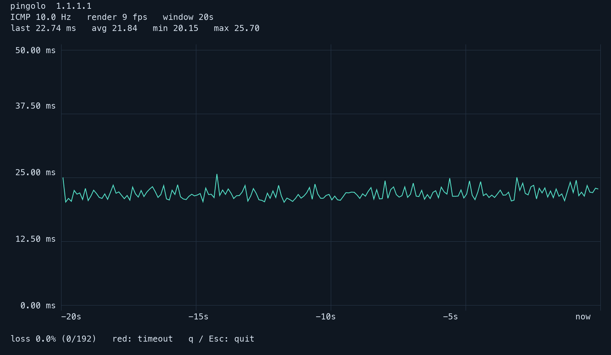

# pingolo

Real-time ping graphs in your terminal. Written in Rust, rendered with Kitty graphics.



Requires [Kitty](https://sw.kovidgoyal.net/kitty/), Rust and the system `ping` command.
Tested on macOS; Linux support is untested.

```sh
cargo install --git https://github.com/davibe/pingolo
pingolo 1.1.1.1
```

Defaults: 10 pings per second, up to 10 fps, a 20-second graph. Press `q`, Escape or Ctrl-C to quit.

```sh
pingolo 192.168.1.1 -i 0.1 -w 30
pingolo 1.1.1.1 --ymax 100 --fps 5
pingolo --help
```

Inside tmux, enable graphics passthrough:

```sh
tmux set -g allow-passthrough on
```

By [Davide Bertola](https://github.com/davibe). [MIT license](LICENSE).
